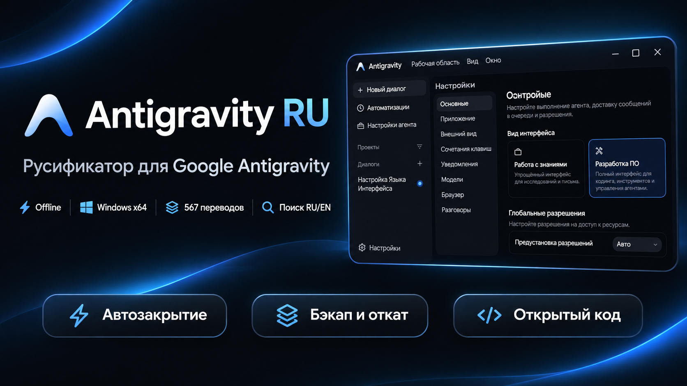
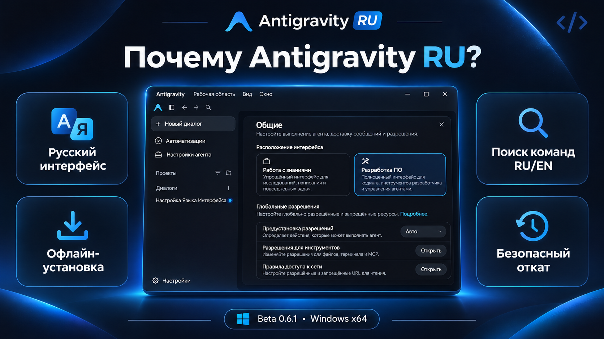

<div align="center">



# Antigravity RU

### Google Antigravity — теперь на русском языке

[](https://github.com/LexesttGPT/antigravity-ru/releases/download/v0.6.1-beta/Antigravity_RU_0.6.1_Beta.zip)

[](https://github.com/LexesttGPT/antigravity-ru/releases)


[](https://github.com/LexesttGPT/antigravity-ru/releases)
[](https://github.com/LexesttGPT/antigravity-ru/stargazers)
[](https://github.com/LexesttGPT/antigravity-ru/issues)

**Бесплатно · Открытый исходный код · Без дополнительных зависимостей**

[Скачать](https://github.com/LexesttGPT/antigravity-ru/releases) • [Установка](#-установка) • [Безопасность](#-безопасность) • [English](#english)

</div>

---

## 🚀 О проекте

**Antigravity RU** — независимый русификатор для Google Antigravity, созданный для комфортной работы с агентной средой разработки на русском языке.

Больше не нужно разбираться в англоязычных настройках, меню и командах. Просто установите русификатор и приступайте к работе.

## ✨ Возможности

<div align="center">

</div>

*Иллюстративное представление интерфейса.*

| Возможность | Поддержка |
|---|:---:|
| 567 переводимых строк интерфейса | ✅ |
| Русскоязычные настройки и меню | ✅ |
| Двуязычный поиск команд RU/EN | ✅ |
| Двуязычный поиск горячих клавиш | ✅ |
| Автоматическое закрытие Antigravity | ✅ |
| Автономное EXE-приложение | ✅ |
| Офлайн-установка | ✅ |
| Резервное копирование | ✅ |
| Восстановление оригинала | ✅ |
| Проверка SHA-256 | ✅ |
| Повторная установка после совместимых обновлений | ✅ |

## 📥 Установка

1. [Скачайте готовый русификатор](https://github.com/LexesttGPT/antigravity-ru/releases/download/v0.6.1-beta/Antigravity_RU_0.6.1_Beta.zip).
2. Распакуйте ZIP-архив.
3. Сохраните незавершённую работу в Antigravity.
4. Запустите `Antigravity_RU_0.6.1_Beta.exe`.
5. Нажмите **Установить / обновить**.
6. Запустите Antigravity и пользуйтесь русским интерфейсом.

> Русификатор автоматически закрывает Antigravity перед установкой. Python, Node.js и Go для запуска готового EXE не требуются.

## 🔄 Обновление и восстановление

После обновления Antigravity повторно запустите русификатор. Если новая версия совместима, перевод можно восстановить.

Для возврата английского интерфейса нажмите **Восстановить оригинал**.

## 💻 Совместимость

| Параметр | Значение |
|---|---|
| Операционная система | Windows x64 |
| Проверенная версия Antigravity | 2.35.1 |
| Версия русификатора | 0.6.1 Beta |
| Подключение к интернету для установки | Не требуется |

Поддержка будущих версий зависит от совместимости архитектуры приложения. Полный перевод новых элементов интерфейса не гарантируется.

## 🛡️ Безопасность

- Открытый для проверки исходный код.
- Отсутствие сетевых запросов со стороны патчера.
- Отсутствие фоновых служб и собственной телеметрии.
- Отсутствие дополнительных MCP-серверов.
- Проверка совместимости перед установкой.
- Резервное копирование оригинальных файлов.
- Возможность отката.
- Сохранение настроек разрешений агентов.

Русификатор изменяет локальный архив ресурсов `app.asar`. Исполняемый файл распространяется без цифровой подписи в статусе Beta.

Не отключайте антивирусную защиту.

Подробнее: [Политика безопасности](SECURITY.md) · [Контрольные суммы](SHA256SUMS.txt)

## 🛠️ Сборка из исходников

Для самостоятельной сборки используется Go.

В PowerShell:

```powershell
$env:CGO_ENABLED="0"
$env:GOOS="windows"
$env:GOARCH="amd64"

go build -trimpath -ldflags="-H=windowsgui -s -w -buildid=" -o Antigravity_RU.exe .
```

Запуск тестов:

```powershell
go test -v ./...
```

## ⭐ Поддержите проект

Если Antigravity RU оказался полезным, поставьте звезду репозиторию!

Каждая звезда помогает другим пользователям найти проект.

- Сообщайте о непереведённых элементах.
- Предлагайте улучшения.
- Делитесь проектом с друзьями и коллегами.

[Сообщить об ошибке или предложить улучшение](https://github.com/LexesttGPT/antigravity-ru/issues/new)

---

## English

**Antigravity RU** is an unofficial offline Russian localization for Google Antigravity on Windows x64.

### Key features

- 567 UI translation entries.
- Bilingual command and keyboard shortcut search.
- Automatic graceful application shutdown.
- Standalone Windows executable.
- Offline installation.
- Compatibility and SHA-256 checks.
- Backup and rollback.

### Installation

Download the ZIP archive from [Releases](https://github.com/LexesttGPT/antigravity-ru/releases), extract it, save your work, run the executable and select Install / Update.

Tested baseline: Antigravity 2.35.1. Future versions may require compatibility updates. The executable is unsigned and distributed as a beta.

This independent community project is not affiliated with or endorsed by Google.

---

<div align="center">

### Made for the developer community

**Antigravity RU**

⭐ Star this repository if you find it useful!

[](https://github.com/LexesttGPT)

</div>
